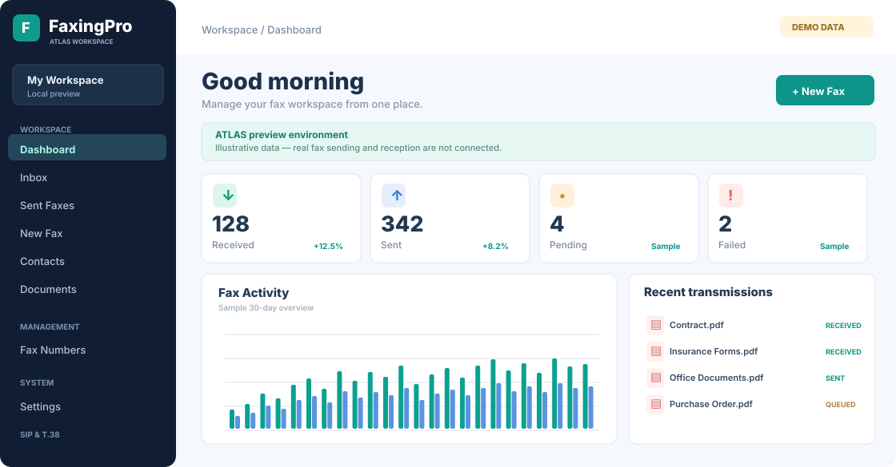

# FaxingPro · ATLAS

**Self-hosted fax management with live Telnyx transport, encrypted documents, and Google Drive recovery copies.**

[**Public product website**](https://migtam628.github.io/FaxingPro/) · [**Desktop releases**](https://github.com/migtam628/FaxingPro/releases) · [**Telnyx deployment**](docs/TELNYX_API_DEPLOYMENT.md) · [**Google Drive backup guide**](docs/GOOGLE_DRIVE_BACKUPS.md)

> **Development status — ATLAS v0.8 (in progress).** The API and ATLAS interface work with genuine stored fax records; there is **no demo dataset** in the live application. Real fax transmission requires your own running Telnyx account and self-hosted HTTPS VPS. This is still a **single-operator pilot**, not a multi-tenant or regulated-document-certified product. See [known limitations](#known-limitations).

*Illustrative ATLAS design direction; the image is not a screenshot of real fax activity. The production interface displays only records received from the server.*

## Features

| Capability | Status | Implementation |
| --- | --- | --- |
| Guided Ubuntu VPS installer | Implemented | Interactive Docker/Compose provisioning, secret generation, optional Caddy HTTPS, update/status checks |
| First-run setup wizard | Implemented | Operator authentication, Telnyx configuration checks and persistent workspace preferences |
| Inbound and outbound faxes | Implemented | Telnyx Programmable Fax API and signature-verified webhooks |
| Fax transmission safety | Implemented | VPS `SEND_ENABLED` and exact `TEST_DESTINATION` checks before sending |
| Inbox, Sent, Documents | Implemented | Genuine PostgreSQL records, status updates and searchable history |
| In-app PDF viewer | Implemented | Authenticated original PDF download/preview and browser printing |
| Encryption at rest | Implemented | AES-256-GCM document encryption in persistent Docker volume |
| Contacts | Implemented in v0.6 | Private PostgreSQL contact create, edit, search and delete |
| Read/unread and archive | Implemented in v0.6 | Database-backed inbound read state and reversible fax archive |
| Webhook event timelines | Implemented in v0.7 | Recorded Telnyx webhook event timestamps per fax; no synthetic event history |
| 30-day daily report | Implemented in v0.7 | UTC daily incoming/outgoing/failed counts from PostgreSQL with recent-activity visualization |
| Fax notification center | Implemented in v0.8 | Real unread inbound and failed transmission alerts, 60-second polling, opt-in browser notifications, stored preferences |
| Backup-health alerts | Implemented in v0.8 | Warn on no recorded archive, latest local archive over 36 hours old, or missing latest Drive checksum record after 2 hours; no deletions or cloud connectivity claims |
| Independent backup health monitor | Opt-in in v0.8 | Read-only local SHA256 validation, failed timer/job checks, live Drive probe and remote checksum comparison; optional HTTPS webhook; [setup guide](docs/BACKUP_HEALTH_MONITOR.md) |
| Manual outbound reconciliation | Implemented in v0.8 (read-only) | Authenticated queue review for unknown or stalled outbound jobs with correlated signed webhook history; never retries or changes status |
| Retention impact preview | Implemented in v0.8 (read-only) | Operator-only age-window aggregate in Backup & Recovery; no policy, deletion, or automatic cleanup |
| Sessions and security history | Implemented | Seven-day secure cookie, failed-login throttling, session counts, revoke-all and operator audit |
| Read-only integration API Token Manager | Implemented in v0.8 | Operator-only create/list/revoke, hashed credentials, 7/30/90-day expiry, last use and scoped permissions |
| Encrypted local backups | Implemented | Streamed PostgreSQL, fax-volume and env archives encrypted to off-VPS age recipient |
| Google Drive backup integration | Implemented | rclone uploader, checksum comparison, offsite status and scheduled post-backup hook |
| Full disaster-recovery rehearsal | Operator action | Independently restore both DB and files on a separate isolated staging host |
| MFA, user roles, retention policy | Future work | Not ready for shared or regulated operations |

## Screens and workflows

ATLAS provides Dashboard, Inbox, Sent Faxes, New Fax, Contacts, Documents, Archive, Fax Numbers, Reports, Fax Transport, Queue, Security, Backup & Recovery, and Settings.

**Contacts:** Save a name, fax number (international E.164), optional email, company and notes. Selecting *Send fax* fills the compose recipient, but does **not** bypass the sending allowlist.

**Inbox:** New inbound records start unread. Opening the original fax marks it read. You can mark it unread again, archive it without deleting PDFs, restore it, or search by title, fax number, and transmission ID. API history searches return at most 250 rows per request; server pagination is available for extensions.

**Documents:** Original encrypted PDFs are decrypted by the authenticated API only when requested; the web app uses an ephemeral object URL for preview. Documents are not served directly from the host filesystem.

**Queue reconciliation:** Job Queue includes an authenticated, read-only review of outbound submissions with unknown outcomes and jobs that have not updated for at least 30 minutes. It shows the FaxingPro ID, Telnyx ID when available, recipient, timestamps and up to 20 recorded signed webhook events per candidate. The endpoint is `GET /api/reconciliation` (up to 50 oldest review candidates); no Telnyx lookup, resend, acknowledgement, status change, or expanded sending permission occurs. An empty list does not guarantee that every fax has been delivered. See [manual reconciliation guide](docs/WEBHOOK_RELIABILITY.md).

**Retention planning:** Backup & Recovery now includes a read-only retention impact preview for 30, 90, 180, 365, 730 or 1825 days. It reports how many fax records are older than the selected threshold, separated into archived terminal, active terminal and nonterminal states, and counts records with attached documents. This is a **planning estimate, not a configured retention policy**; no records, encrypted PDFs, backups, or volumes are deleted. The operator-only endpoint is `GET /api/retention/preview?days=365`. See [retention preview guide](docs/RETENTION_PREVIEW.md).

**Notifications:** The bell in ATLAS displays actual unread incoming faxes, failed transmissions and backup-health warnings. The operator can open the corresponding fax or navigate to Backup & Recovery, refresh alerts, and opt into desktop notifications with browser permission. FaxingPro polls every 60 seconds; this is **not instantaneous server push**. Local backup warnings use PostgreSQL records: no backup completed, the latest archive more than 36 hours old, or no Google Drive checksum record for the newest local archive after 2 hours. **These alerts do not probe live Google Drive availability or prove backup restoration.** No third-party notification services or fake fax activity feed are used.

**Independent backup health:** For monitoring outside the ATLAS notification feed, run the [opt-in independent backup monitor](docs/BACKUP_HEALTH_MONITOR.md). It verifies the newest local encrypted archive against its checksum manifest, checks the backup timer/job and probes actual Google Drive read access and the latest remote archive. Its own daily systemd unit and optional HTTPS webhook are **not enabled by a code update**. No documents are deleted or modified. A full restoration rehearsal is still required.

**Security:** A single operator signs in using `API_TOKEN` in a same-origin HTTPS session; invalid-token submissions are throttled and security events are recorded in PostgreSQL. Neither the bearer key nor the Google Drive private tokens should be committed to source control.

## Easy Ubuntu VPS installer

FaxingPro includes a **guided Ubuntu VPS installer** that provisions the Docker Engine and Compose plugin when needed, downloads FaxingPro, generates strong independent database/operator/media/storage secrets, deploys the PostgreSQL/API/web containers, and optionally runs a dedicated Caddy HTTPS gateway. The installer also offers **check**, **status** and **safe update** modes.

**Important:** The VPS setup is streamlined, but DNS ownership, Telnyx credentials, DID assignment and Google Drive OAuth still require your authorization. This is a *single-operator pilot*, not a turnkey regulated fax service.

### 1. Requirements and installation choices

- A fresh Ubuntu VPS (or an Ubuntu server without an existing FaxingPro installation), root/sudo access, outbound internet, and enough disk capacity for Docker images, the database, and encrypted PDFs.
- A domain/subdomain you own such as `fax.example.com`. Point its DNS **A** record at the VPS public IP; open inbound **TCP 80/443** when using automatic Caddy HTTPS. Keep your SSH access available.
- Your **real Telnyx Ed25519 webhook verification public key** (32-byte Base64 or 64-character hex), from Telnyx Mission Control. The backend requires it even with sending disabled. Optionally provide the Telnyx API V2 secret, Fax Application ID and purchased US E.164 DID (`+1...`) during setup; missing items prevent the full ATLAS gateway setup wizard from completing.
- **Choose `auto`** for a dedicated fresh VPS with free 80/443. **Choose `existing`** for a shared VPS that already runs Nginx, Caddy, Traefik, MooBee or other services. **Choose `none`** to use localhost only and configure HTTPS yourself. The installer will not modify an existing proxy.

### 2. Download and run on a *new* Ubuntu VPS

SSH into your VPS and execute:

~~~bash
curl -fsSLo faxingpro-install.sh \
  https://raw.githubusercontent.com/migtam628/FaxingPro/main/scripts/install-vps.sh

# Review any downloaded root-level installer before execution.
less faxingpro-install.sh

# Guided installation (asks for hostname, proxy mode and Telnyx settings).
sudo bash faxingpro-install.sh
~~~

Alternatively, visit the [latest GitHub Release](https://github.com/migtam628/FaxingPro/releases/latest), download **`faxingpro-install.sh`** and **`SHA256SUMS`**, and verify the installer checksum in their download directory before running:

~~~bash
grep '  faxingpro-install.sh$' SHA256SUMS | sha256sum -c -
sudo bash faxingpro-install.sh
~~~

The release's `README.md` and `FaxingPro-Setup-Docs.zip` are offline reference materials. The release checksum file covers the published installers and documentation assets. **Do not execute a remote `curl | sudo bash` pipeline without inspecting what you downloaded.**

For a **shared VPS with an existing reverse proxy**, choose the non-invasive mode:

~~~bash
sudo bash faxingpro-install.sh --proxy existing --domain fax.example.com
~~~

It leaves that existing proxy alone and binds the FaxingPro frontend to `127.0.0.1:8092` on the **host**. Route the hostname to that port from a **host-level reverse proxy**. If your reverse proxy runs inside Docker, its `127.0.0.1` means the proxy container, not the VPS: explicitly connect it to the `faxingpro-telnyx_default` network and forward to `faxingpro-telnyx-web-1:80`, or use another reviewed trusted network route.

**Noninteractive administration:** supply `--yes --domain fax.example.com --proxy auto` and the environment variable `FAXINGPRO_TELNYX_PUBLIC_KEY`; optional Telnyx variables are `FAXINGPRO_TELNYX_API_KEY`, `FAXINGPRO_TELNYX_APP_ID`, and `FAXINGPRO_TELNYX_FROM_NUMBER`. Use a secret-aware provisioner, not an exposed shell command or shared terminal history, for private Telnyx keys.

### 3. What the installer creates and what it leaves untouched

| Component | New installation behavior |
| --- | --- |
| Docker Engine + Compose | Reused when healthy; otherwise installed from the official Docker Ubuntu APT repository |
| FaxingPro application | Cloned into `/opt/faxingpro` unless `--dir /absolute/path` is specified |
| Database and fax files | Persistent Compose-managed PostgreSQL and encrypted-document Docker volumes |
| Credentials | Four locally generated distinct 64-character hex values: `DB_PASSWORD`, `API_TOKEN`, `MEDIA_SIGNING_SECRET`, `STORAGE_ENCRYPTION_KEY` |
| Protected settings | `deployment/telnyx/.env` (mode 0600) and a local installer proxy profile |
| Network and HTTPS | Web listens at `127.0.0.1:8092` by default; optional standalone Caddy only if 80/443 are free |
| Sending safety | `SEND_ENABLED=false`, `TEST_DESTINATION` blank; never enables arbitrary outbound faxing |
| Validation | Checks Docker Compose configuration, builds/starts containers and waits for local `/healthz` |
| Existing installations | Refuses to overwrite an existing target checkout or detected FaxingPro data volumes |

**Do not run a fresh install over an existing FaxingPro directory, even if your current version is behind.** Do not use `docker compose down -v`, delete persistent volumes, or regenerate `STORAGE_ENCRYPTION_KEY`; that would risk losing access to saved documents.

### 4. Finish setup after the installer

1. Verify DNS and HTTPS at `https://YOUR-FAX-HOST`. For `auto` mode, Caddy can only issue a certificate when DNS points to the VPS and public 80/443 reach the server. For `existing` mode, configure routing in your existing reverse proxy without replacing its other sites.
2. Privately retrieve the generated operator token **on the VPS** (do not paste it into GitHub or chat):

   ~~~bash
   sudo grep '^API_TOKEN=' /opt/faxingpro/deployment/telnyx/.env
   ~~~

3. Open the actual **HTTPS** ATLAS website, sign in using the operator token, verify the Telnyx readiness checks, and complete the workspace setup. Never sign in on the public GitHub Pages marketing site.
4. In Telnyx Mission Control, create/configure your Programmable Fax application, attach the purchased DID and outbound profile, and set the webhook endpoint to `https://YOUR-FAX-HOST/webhooks/telnyx` **only after HTTPS and webhook-signature security have been verified**.
5. Test with a benign incoming fax and confirm the encrypted PDF is accessible. Outbound remains locked until you deliberately configure `SEND_ENABLED` and a single explicitly authorized `TEST_DESTINATION`; the installer does **not** change these controls.
6. Configure encrypted database/document/configuration backups and Google Drive offsite copies separately (next section).

### 5. Health checks, safe updates and troubleshooting

New installations in the default directory:

~~~bash
sudo bash /opt/faxingpro/scripts/install-vps.sh --status
sudo bash /opt/faxingpro/scripts/install-vps.sh --update
~~~

The `--update` command fast-forwards the existing Git checkout and rebuilds **only** the web and API services. It does **not** replace `.env`, erase PostgreSQL or PDF volumes, delete backups, or change other deployed websites. Take an encrypted backup and verify its offsite copy before major upgrades.

For an older installation such as `/root/FaxingPro`, pass the actual existing path; **do not run a fresh install**:

~~~bash
sudo bash /root/FaxingPro/scripts/install-vps.sh --update --dir /root/FaxingPro
~~~

The script also supports `--check` (read-only host checks), `--self-test` (local input-guard tests), and `--port 9092` on *new* installs if 8092 is already in use. For diagnostics:

~~~bash
curl -fsS http://127.0.0.1:8092/healthz

cd /opt/faxingpro
docker compose -f deployment/telnyx/compose.yaml \
  --env-file deployment/telnyx/.env ps

docker compose -f deployment/telnyx/compose.yaml \
  --env-file deployment/telnyx/.env logs --tail=60 api web
~~~

If the website does not open, check its DNS A record, 80/443 firewall rules, TLS provisioning, and reverse-proxy routing first. If `/healthz` fails, inspect API logs and ensure your Telnyx public webhook key is correctly formatted. If the server already has another FaxingPro installation or occupied 80/443, use `--update` or `--proxy existing` rather than replacing working services.

### 6. Daily encrypted backups and Google Drive

A reliable recovery requires **all three**: PostgreSQL database, encrypted PDF volume, **and the original storage encryption key**. Generate an `age` recovery identity **on another trusted computer**, keep its *private* half off the VPS, and use only its public `age1...` recipient with the server backup scripts.

~~~bash
# On the VPS after configuring an age public recipient and installing age:
cd /opt/faxingpro
export FAXINGPRO_AGE_RECIPIENT='age1YOUR_REAL_PUBLIC_RECIPIENT'
bash scripts/faxingpro-backup.sh

# Only after a backup was copied and verified on a separate device:
bash scripts/install-faxingpro-backup-timer.sh --check
bash scripts/install-faxingpro-backup-timer.sh --install
unset FAXINGPRO_AGE_RECIPIENT
~~~

**Google Drive:** Configure a dedicated Google Drive rclone OAuth remote named `faxingpro-drive` using your own Google OAuth client, then connect it with:

~~~bash
cd /opt/faxingpro
bash scripts/install-faxingpro-drive.sh --check
bash scripts/install-faxingpro-drive.sh --install
bash scripts/faxingpro-drive-upload.sh --upload-pending
~~~

The backup scripts transfer **only age-encrypted archives**, verify uploaded checksums and preserve local files. They do not delete old backups. Google Drive transfer verification is **not** proof of a successful recovery: rehearse restoration on an **isolated staging VPS**. Never upload your `age` private identity, `rclone.conf`, or unencrypted `.env` to GitHub or support chats.

For detailed backup recovery and Google OAuth headless authorization, use [Backup & Recovery](docs/BACKUP_RECOVERY.md), [Google Drive setup](docs/GOOGLE_DRIVE_BACKUPS.md), and [VPS installer reference](docs/VPS_ONE_CLICK_INSTALL.md).

### 7. Desktop builds are clients, not VPS servers

GitHub Releases also supplies a Windows NSIS installer, macOS Intel/Apple silicon DMGs, and Linux AppImage/DEB packages. They are **unsigned preview desktop clients**: on first launch, enter the URL of your own deployed HTTPS FaxingPro VPS. A desktop installer alone does **not** set up Telnyx, PostgreSQL, or an internet-reachable fax service.

### 8. What's inside a GitHub Release

Every successful [release build](https://github.com/migtam628/FaxingPro/releases) publishes the same installation instructions and files together:

| Download | What it provides |
| --- | --- |
| `faxingpro-install.sh` | Guided Ubuntu VPS/server installer |
| `README.md` | Full setup, DNS/HTTPS, Telnyx, backup, Google Drive, update, recovery and troubleshooting instructions |
| `FaxingPro-Setup-Docs.zip` | Offline bundle with README and detailed installation/operations guides |
| `RELEASE_NOTES.md` | Installation instructions automatically copied from the release commit's README |
| `SHA256SUMS` | Integrity hashes for the installer, documentation, notes and desktop installers |
| `FaxingPro-0.1.0-*.exe/.dmg/.AppImage/.deb` | Unsigned Windows/macOS/Linux desktop preview clients (requires your running VPS) |

**Installation instructions appear in the release description itself**, not only in separate documentation links. Keep the private Telnyx API key, operator token, encryption keys, rclone credentials, backup identity and fax documents off GitHub and out of downloaded release assets.

## Deployment: Docker and Telnyx

Requirements: Ubuntu or equivalent Docker host, Docker Compose, Telnyx Fax API credentials, public HTTPS reverse proxy, and secrets stored only in `deployment/telnyx/.env`.

~~~bash
git clone https://github.com/migtam628/FaxingPro.git
cd FaxingPro
cp deployment/telnyx/.env.example deployment/telnyx/.env
# Set strong unique secrets, Telnyx credentials, public HTTPS URL and DID.
# Do not commit or print the actual .env.
docker compose -f deployment/telnyx/compose.yaml \
  --env-file deployment/telnyx/.env up -d --build
curl -fsS http://127.0.0.1:8092/healthz
~~~

The compose stack runs `web`, `api`, and `db`; **the 8092 frontend port is bound to localhost by default** for use behind your existing HTTPS reverse proxy. All fax records and documents live in named persistent Docker volumes. An API rebuild should never destroy those volumes.

**On an existing VPS**:

~~~bash
cd ~/FaxingPro
git pull --ff-only
docker compose -f deployment/telnyx/compose.yaml \
  --env-file deployment/telnyx/.env up -d --no-deps --build api web
docker compose -f deployment/telnyx/compose.yaml \
  --env-file deployment/telnyx/.env restart web
~~~

> **Safety:** Do not run `docker compose down -v` or rotate `STORAGE_ENCRYPTION_KEY` unless you are performing a fully planned recovery or key migration. Rebuilding the API introduces additive contact and fax-state columns; it does not clear old transmissions. `SEND_ENABLED` and `TEST_DESTINATION` are deliberately not changed by application updates.

For complete Telnyx webhook and Caddy details, read [Telnyx deployment](docs/TELNYX_API_DEPLOYMENT.md).

## Public GitHub Pages site

**https://migtam628.github.io/FaxingPro/**

The [Pages workflow](.github/workflows/pages.yml) builds the public **product landing page**, accessible without private credentials. It presents the architecture, features and release links. Pages serves **static assets only** and does not connect to your fax API, collect operator credentials, or contain sample fax records.

Under GitHub repository Settings → Pages, select **Source: GitHub Actions**. The workflow runs on commits to `main`, validates Vite assets and deploys the `/FaxingPro/` project path.

## Desktop application: Windows, macOS and Linux

Visit [GitHub Releases](https://github.com/migtam628/FaxingPro/releases) for preview installer builds:

- **Windows** — NSIS `.exe`
- **macOS** — Intel and Apple silicon `.dmg`
- **Linux** — AppImage and Debian `.deb`

On first launch, enter your **existing self-hosted HTTPS FaxingPro server origin**, such as `https://fax.yourdomain.com`. The Electron shell opens that website in a sandboxed Chromium window. Its session cookies belong to your HTTPS server. The chosen URL is remembered locally (not the operator token); access can be revoked from ATLAS → Security.

The desktop installer **does not run PostgreSQL, Telnyx, or a fax gateway by itself**. Local `file://` authentication is not used. Preview installers are currently unsigned/unnotarized and automated updates are not configured; follow your OS security procedures and verify the release source.

You can build a local development copy with:

~~~bash
npm install
npm run build
npm run desktop
~~~

## Managing API access safely

**Administrator sign-in:** A new VPS installation generates a random 64-character hex `API_TOKEN` in `deployment/telnyx/.env`. Sign in at **your own HTTPS FaxingPro server**, not the public GitHub Pages site. Existing operator sessions are HttpOnly, Secure and SameSite=Strict. You can view active sessions and revoke all browser sessions in ATLAS → **Security**.

**Read-only integration tokens:** The Security panel now has an **API Tokens** manager. An authenticated operator can name a new token, select `faxes:read`, `contacts:read` and/or `reports:read`, and select **7, 30 or 90 days**. The secret is shown **exactly once** at creation—copy it to a password manager before dismissing it. Only its SHA-256 digest is stored in PostgreSQL; token metadata includes a safe prefix, scope, expiration, last-used timestamp and revocation state. Up to 10 active credentials are allowed.

~~~bash
# Example: call a READ-ONLY resource using a token you created in ATLAS.
# Do not paste the real token into public terminal history or GitHub.
read -rsp 'Read-only FaxingPro token: ' FAXINGPRO_READ_TOKEN; echo
curl -fsS -H "Authorization: Bearer $FAXINGPRO_READ_TOKEN" \
  https://fax.example.com/api/faxes
unset FAXINGPRO_READ_TOKEN
~~~

| Token scope | Allowed integration GET endpoints | Not allowed |
| --- | --- | --- |
| `faxes:read` | `/api/faxes`, `/api/stats`, `/api/faxes/:id/events` | PDF downloads, sending and record changes |
| `contacts:read` | `/api/contacts` | Creating/editing/deleting contacts |
| `reports:read` | `/api/reports/daily` | Changing settings or reporting data |

Read-only tokens **cannot** exchange themselves for browser operator sessions, download encrypted fax PDFs, send/retry fax jobs, change backups, manage sessions, or create/revoke other tokens. An integration token passed in an explicit `Authorization` header cannot inherit administrator authority from a browser cookie. Expired and revoked tokens stop working immediately; listing tokens never returns their secret.

**Rotating the master `API_TOKEN` still requires VPS administration**, and recreating the API container to load the new environment value. The UI currently manages *integration tokens*, not the original master administrator token. No user accounts, MFA or scoped write/sending tokens are implemented. For detailed controls and safe CLI rotation, see [Security & Sessions](docs/SECURITY_SESSIONS.md).

## Backup & Recovery

The system preserves three independent recovery components: **PostgreSQL database**, **AES-GCM encrypted PDF volume**, and **VPS encryption/configuration secrets**. The [Backup & Recovery runbook](docs/BACKUP_RECOVERY.md) uses an off-VPS `age` private identity to encrypt and validate archives. The optional [Google Drive integration](docs/GOOGLE_DRIVE_BACKUPS.md) uses rclone with your own Google OAuth app to upload encrypted archives, verify checksums and show per-snapshot offsite status.

**Webhook consistency:** Signed Telnyx events are recorded once by event ID. Older events, direction-mismatched events, and events arriving after a terminal result cannot overwrite the confirmed fax status or its associated page count/failure/media metadata. This does **not** automatically retry unknown-outcome transmissions; operator reconciliation remains required. [Webhook reliability and test cases](docs/WEBHOOK_RELIABILITY.md).

**Automated recovery rehearsal:** The backend CI now seeds a synthetic AES-256-GCM-encrypted PDF and fax record, creates a real age-encrypted database/document/configuration backup, restores the archives into **new network-disconnected Docker containers and uniquely named temporary volumes**, and verifies both the PostgreSQL row and the original decrypted PDF digest. This test is intentionally restricted to disposable GitHub Actions runners; it never runs on the live VPS.

**Important:** CI validates the **backup/restore mechanism using synthetic data**, not recovery of your actual Google Drive archives. Google Drive checksums only prove transferred bytes matched at upload time. An operator still must download a real encrypted backup to a trusted separate computer, confirm the private age identity is recoverable, and rehearse an isolated production-data restoration under an approved runbook. The Google Drive OAuth configuration and age private identity must never be committed or exposed in logs, screenshots or tickets. Scheduled backups do not delete old archives automatically; monitor storage growth.

## GitHub release publishing permissions

GitHub Actions builds and stores five preview installers on each release workflow. Creating a **GitHub Release** requires a separate write action, and it can fail with HTTP 403 even when all OS packaging jobs succeed.

The [release workflow](.github/workflows/release.yml) requests `contents: write`. If the repository or account policy prevents the default Actions token from publishing—especially when the target commit modifies workflow files—provide a dedicated repository Actions secret named **FAXINGPRO_RELEASE_TOKEN** with only the permissions required for this repository (Contents: read/write and, when publishing a commit that changes workflows, Workflows: read/write), or adjust the repository policy using an authorized account. Never paste the secret into an issue, commit, or chat.

To change the policy in GitHub, open **Settings → Actions → General → Workflow permissions**. After permission changes, run [Build and Release](https://github.com/migtam628/FaxingPro/actions/workflows/release.yml) again using **Run workflow**. Until a release appears in the Releases list, installers remain accessible as individual **Actions run artifacts** (subject to GitHub's artifact retention).

## Development and CI

~~~bash
npm install
npm test
npm run build
npm run dev
~~~

| Workflow | Purpose |
| --- | --- |
| [Deploy ATLAS Website](.github/workflows/pages.yml) | Build/test static product landing page and publish GitHub Pages |
| [Validate Telnyx Fax Backend](.github/workflows/telnyx-ci.yml) | Node/API and signed webhook tests, real age-encrypted backup, synthetic database/PDF restore drill, mocked Google Drive checks |
| [Build and Release](.github/workflows/release.yml) | Run tests; build Windows, macOS and Linux installers; publish preview release assets |

Deployment to your VPS remains **manual** and isolated from your other services: pushing to GitHub does not automatically restart your production FaxingPro containers.

## Known limitations

- Currently **single-operator**. MFA, separate user accounts and per-role authorization are not implemented.
- Outbound faxing is constrained to the configured test destination until a dedicated sender-safety rollout is approved.
- Contact changes are not automatically synchronized with Telnyx or external CRMs.
- Reporting includes 30-day daily activity but lacks full usage/cost analytics; email/SMS alerts, retention policies and controlled sending retries still need implementation. The read-only reconciliation queue does not resolve provider outcomes or authorize retransmission.
- The public website and desktop installers are not themselves a fax service. The HTTPS VPS and Telnyx backend must be available.
- An isolated CI restore drill covers the synthetic backup format, but **a real off-VPS recovery drill using actual Google Drive archives, key access and an independently isolated staging environment**, plus a security audit, remain outstanding before regulated workflows.

## Documentation

- [Deployment and Telnyx API](docs/TELNYX_API_DEPLOYMENT.md)
- [Signed webhook reliability and reconciliation safeguards](docs/WEBHOOK_RELIABILITY.md)
- [Security and operator sessions](docs/SECURITY_SESSIONS.md)
- [PostgreSQL and encrypted document recovery](docs/BACKUP_RECOVERY.md)
- [Google Drive setup](docs/GOOGLE_DRIVE_BACKUPS.md)
- [Developer environment](docs/DEVELOPMENT.md)
- [System architecture](docs/ARCHITECTURE.md)
- [Published releases](https://github.com/migtam628/FaxingPro/releases)

---

**FaxingPro ATLAS** — self-hosted, operator-controlled fax operations.