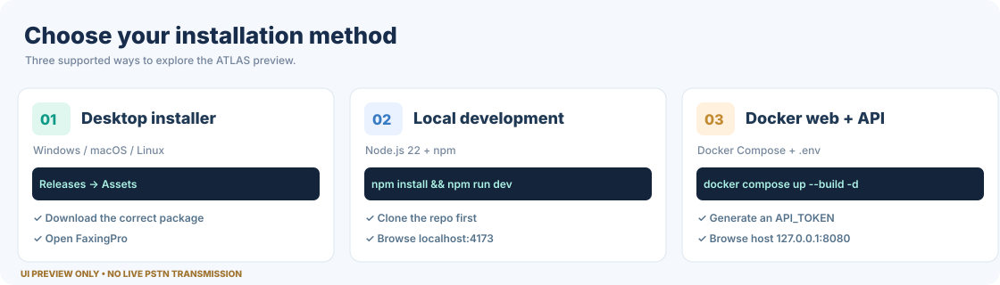
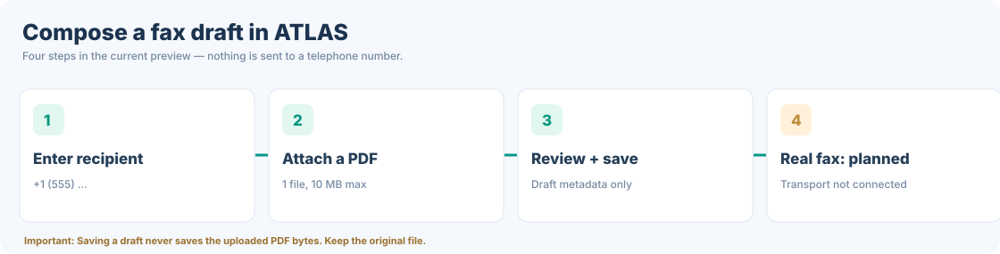
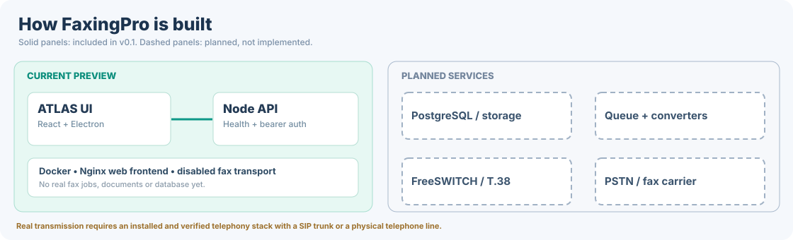

# FaxingPro

**ATLAS — Self-hosted fax workspace**

Self-hosted fax management for Windows, macOS, Linux and the web, with live Telnyx Programmable Fax API integration.

[**Download installers**](https://github.com/migtam628/FaxingPro/releases) · [**GitHub Actions**](https://github.com/migtam628/FaxingPro/actions/workflows/release.yml) · [**Developer guide**](docs/DEVELOPMENT.md) · [**Architecture**](docs/ARCHITECTURE.md)

> [!IMPORTANT]
> **v0.5 development — Live Telnyx fax workspace with secure onboarding, encrypted recovery tools and opt-in daily local backups.**
> The self-hosted deployment supports real inbound/outbound faxes, signed Telnyx webhooks,
> encrypted PDF storage, PostgreSQL history and 7-day operator login sessions.
> On first launch, the wizard verifies the server, checks the configured Telnyx settings
> and saves the workspace name/timezone in PostgreSQL. **No demo data is shipped in ATLAS.**
> Sending still follows the VPS-level `SEND_ENABLED` and `TEST_DESTINATION` safety gates.
> The static GitHub Pages site cannot be used as a real fax backend.

*Illustrated interface overview using synthetic fax records and numbers. This is a vector preview of the ATLAS layout—not evidence of real fax activity or a live product screenshot.*

## Contents

- [Current features](#current-features)
- [Public GitHub Pages preview](#public-website--github-pages)
- [Desktop installation](#a-install-a-desktop-release-recommended-for-a-quick-preview)
- [Local web development](#b-run-the-web-ui-locally)
- [Docker hosting](#c-host-the-web-application-and-api-yourself-docker)
- [ATLAS walkthrough](#illustrated-atlas-walkthrough)
- [API and Docker reference](#self-hosted-api--docker)
- [Architecture and roadmap](#architecture--roadmap)
- [Releases](#github-actions--downloads)
- [Troubleshooting](#troubleshooting--security)

## Current features

| Feature | Status | What it does |
| --- | --- | --- |
| First-use setup wizard | ✅ Live | Secure operator sign-in, Telnyx readiness checks, workspace settings stored on VPS |
| Dashboard and statistics | ✅ Live | Verified counts from PostgreSQL; no sample KPI data |
| Inbox / Sent / Documents | ✅ Live | Real fax records, search, download of encrypted originals |
| Fax composer | ✅ Live | Submit a PDF (up to 10 MB) via Telnyx, subject to configured destination restrictions |
| Delivery receipts | ✅ Live | Signed Telnyx webhooks update real received/delivered/failed states |
| Persistent operator session | ✅ Live | 7-day HttpOnly Secure cookie, server-side revocation |
| Fax document encryption | ✅ Live | AES-256-GCM encrypted files in an isolated persistent Docker volume |
| In-app fax PDF viewer | ✅ Live | Authenticated blob-based multi-page PDF preview, native browser controls, download and print |
| Backup & Recovery Center | ✅ Pilot | Read-only local backup freshness; opt-in daily systemd backup timer; offsite replication, restore drills and retention are not yet configured |
| Contacts and read/unread | ⏳ Planned | Empty, clearly labeled states; no fake contacts |
| Historical trend reports | ⏳ Planned | Actual aggregate counts exist, but trend charts are not yet implemented |
| Multiple users, MFA, compliance controls | ⏳ Not production ready | Single-operator pilot; not suitable for regulated/PHI documents |

For deploying the fax service, read the [**Telnyx VPS deployment guide**](docs/TELNYX_API_DEPLOYMENT.md). To create secure recovery archives, follow the [**v0.4 Backup & Recovery runbook**](docs/BACKUP_RECOVERY.md) before handling sensitive documents.
On an existing installation, **your real fax records are preserved**. The wizard appears
once after this update and will not appear again after you finish it, unless the server
configuration is reset. API tokens and Telnyx credentials remain in the VPS `.env` file.

## Public website — GitHub Pages

The ATLAS web preview can be published at **https://migtam628.github.io/FaxingPro/** through the dedicated [**Deploy ATLAS Website to GitHub Pages**](https://github.com/migtam628/FaxingPro/actions/workflows/pages.yml) workflow.

**GitHub Pages only (static landing/client preview with no sample records):**

1. Open [**FaxingPro → Settings → Pages**](https://github.com/migtam628/FaxingPro/settings/pages).
2. Under **Build and deployment → Source**, select **GitHub Actions**. Don't select **Deploy from a branch** for this React/Vite application.
3. Save the setting if prompted.
4. Open [**Actions → Deploy ATLAS Website to GitHub Pages**](https://github.com/migtam628/FaxingPro/actions/workflows/pages.yml). If necessary, select **Run workflow** and the `main` branch.
5. After the **Publish website** job succeeds, open **https://migtam628.github.io/FaxingPro/**.

The workflow builds Vite to `dist/` and uses `VITE_BASE_PATH=/FaxingPro/`, which makes the generated JavaScript, CSS, and local font links work under the GitHub Pages project URL. It does **not** modify Electron builds (which still use a relative asset base).

> [!IMPORTANT]
> Pages hosts **only the static ATLAS preview**. It cannot host this project's Node API, Docker containers, or a real telephone fax gateway. The static deployment displays no fake transactions. It directs operators to their self-hosted HTTPS installation for real faxing and never accepts VPS credentials.

If the page is blank, inspect the browser console for missing JavaScript/CSS files and review the [Pages workflow logs](https://github.com/migtam628/FaxingPro/actions/workflows/pages.yml). If you get a 404, confirm the publishing source is **GitHub Actions** and that the deployment completed successfully.

## Installation guide

### A. Install a desktop release (recommended for a quick preview)

1. Go to **[GitHub Releases](https://github.com/migtam628/FaxingPro/releases)**.
2. Open the most recent compatible release and expand **Assets**.
3. Download the appropriate application package from the table below.
4. Install or launch it, then open **FaxingPro**.
5. Explore **Dashboard → Inbox → New Fax → Documents → Settings**. Real fax service is **not enabled**.

| Platform | v0.1.0 asset name | Instructions |
| --- | --- | --- |
| Windows x64 | `FaxingPro-0.1.0-win-x64.exe` | Launch the installer, select destination, finish installation |
| macOS Apple Silicon | `FaxingPro-0.1.0-mac-arm64.dmg` | Open the DMG, drag FaxingPro into Applications |
| macOS Intel | `FaxingPro-0.1.0-mac-x64.dmg` | Open the DMG, drag FaxingPro into Applications |
| Linux x64 | `FaxingPro-0.1.0-linux-x86_64.AppImage` | Make the AppImage executable and run it |
| Ubuntu / Debian x64 | `FaxingPro-0.1.0-linux-amd64.deb` | Install the downloaded `.deb` |

**Linux AppImage** (run in the folder containing the downloaded file):

~~~bash
chmod +x FaxingPro-0.1.0-linux-x86_64.AppImage
./FaxingPro-0.1.0-linux-x86_64.AppImage
~~~

**Ubuntu / Debian**:

~~~bash
sudo apt install ./FaxingPro-0.1.0-linux-amd64.deb
~~~

> [!NOTE]
> The preview installers are not signed/notarized; operating systems may show publisher warnings. Only download from the project's GitHub Release assets. Filename versions will change in subsequent releases.

### B. Run the web UI locally

**Prerequisites:** Git, npm and **Node.js 22** (recommended and used in GitHub CI; the package declares Node 20+).

~~~bash
git clone https://github.com/migtam628/FaxingPro.git
cd FaxingPro
npm install
npm run dev
~~~

Open **http://localhost:4173**. This runs the interface with synthetic records, without requiring a telephone carrier.

To run checks or generate the production web build:

~~~bash
npm test
npm run build
~~~

To run the Electron desktop development shell, leave `npm run dev` running in **Terminal 1**, then use **Terminal 2**:

~~~bash
# macOS / Linux
FAXINGPRO_DEV_URL=http://localhost:4173 npm run desktop
~~~

Windows PowerShell:

~~~powershell
$env:FAXINGPRO_DEV_URL = "http://localhost:4173"
npm run desktop
~~~

To generate platform-native installers from source:

~~~bash
npm run build
npm run dist
~~~

Build outputs are written to `release/`; GitHub Actions provides the recommended automated cross-platform builds.

### C. Host the web application and API yourself (Docker)

**Prerequisites:** Docker Engine + Docker Compose. These commands also work on a suitable Ubuntu VPS.

~~~bash
git clone https://github.com/migtam628/FaxingPro.git
cd FaxingPro
cp .env.example .env
~~~

Generate a secret token on Linux/macOS:

~~~bash
openssl rand -hex 32
~~~

Edit `.env` and **replace the example API_TOKEN** with the random value you generated. Keep it private.

~~~dotenv
API_TOKEN=PASTE_YOUR_64_CHARACTER_SECRET_HERE
FAX_TRANSPORT=disabled
ALLOWED_ORIGINS=http://localhost:4173,http://127.0.0.1:4173
~~~

Start the containers and test the endpoint:

~~~bash
docker compose up --build -d
docker compose ps
curl http://127.0.0.1:8092/healthz
~~~

The expected JSON includes `"ok": true` and **`"faxEnabled": false`**. This is correct: the starter API is online but no fax engine is connected.

**Open the web UI:** **http://127.0.0.1:8092** from the **Docker host**.

**Accessing a remote Ubuntu server:** The Compose deployment only binds the website to the host's **127.0.0.1:8092**. Use an SSH tunnel from your own computer:

~~~bash
ssh -L 8080:127.0.0.1:8092 YOUR_USER@YOUR_SERVER
~~~

While the SSH connection is open, browse to **http://127.0.0.1:8092** on your local computer. For permanent remote use, configure a trusted **HTTPS reverse proxy or private network**. Do not publish an HTTP management port to the internet.

**Useful server commands:**

~~~bash
docker compose logs --tail=100 api
docker compose logs --tail=100 web
docker compose restart
docker compose down
~~~

## Illustrated ATLAS walkthrough

### 1 — Explore the Dashboard

The midnight-navy sidebar organizes the workspace and system sections. The Dashboard shows **Received, Sent, Pending and Failed** example KPI cards, fax activity charts and recent transmissions. A **DEMO DATA** indicator identifies the records as illustrative.

### 2 — Browse Inbox and Sent Faxes

Open **Inbox**, use the **All inbox** / **Unread** tabs, and search by document name, contact, fax number or reference ID. Click a fax row to open the document viewer.

Open **Sent Faxes** to view example outgoing records. Saved local drafts appear in the **Drafts** tab; they are not real transmissions.

### 3 — Compose a PDF draft

1. Select **New Fax**.
2. Enter a recipient number and an optional subject.
3. Attach a **single PDF up to 10 MB**.
4. Review the attachment inside the PDF preview.
5. Choose **Save local draft** to store the draft's metadata in local storage.
6. Keep your original file: **saving a draft does not persist the attached PDF itself**.

**Queue Fax is disabled** until the future fax gateway has been built and verified. Cover-sheet templates and scheduled sends are currently interface placeholders.

### 4 — View a document

Choose any sample record. The Document Viewer displays a placeholder page and illustrative details. **Demo documents cannot be downloaded** because they are not actual stored PDFs. The Activity panel is also illustrative.

### 5 — Test the self-hosted API

1. Start the Docker services using [the setup above](#c-host-the-web-application-and-api-yourself-docker).
2. From the hosted web UI, go to **Settings → API Connection**.
3. Enter the API URL `http://127.0.0.1:8092` when the browser reaches the Docker host directly or through the described tunnel.
4. Enter the same **API_TOKEN** from your `.env`.
5. Select **Test connection**.

A successful connection reports **FaxingPro API v0.1**, **transport: disabled**, and **fax: disabled**. It verifies the API's availability, not a working telephone fax service.

> [!CAUTION]
> For access from another machine, use a URL reachable from **that** device and trusted HTTPS (or a secure tunnel). Direct Electron/file-origin access can require special CORS handling; do not loosen browser origin checks to `*` or `null` indiscriminately. Avoid uploading sensitive personal or medical documents into this early preview.

### 6 — Review administration pages

The workspace includes Fax Numbers, Team Members, Reports, Fax Server, SIP & T.38, Job Queue, Security and Settings. They demonstrate the **future user experience**; operational SIP provisioning, live activity logs and production user permissions are not implemented yet.

## Self-hosted API & Docker

The included Node API rejects startup if `API_TOKEN` contains fewer than **32 characters** or if an unsupported fax transport is selected. The `api` container is accessible only to the internal Compose network; Nginx serves the UI and forwards selected requests.

| Endpoint | Auth | Current behavior |
| --- | --- | --- |
| `GET /healthz` | Public | Status JSON; `faxEnabled: false` |
| `GET /api/capabilities` | Bearer token | No inbound/outbound transport enabled |
| `GET /api/faxes` | Bearer token | Empty list until durable storage is implemented |
| `POST /api/faxes` | Bearer token | **503** — live fax delivery deliberately disabled |

**Not included** in the current containers: FreeSWITCH, SpanDSP, SIP trunks, PostgreSQL, Redis, encrypted document storage or production account management.

## Telnyx Programmable Fax API pilot (new)

The [Telnyx API deployment guide](docs/TELNYX_API_DEPLOYMENT.md) covers persistent PostgreSQL records, inbound PDF capture, verified webhooks and a test-only outbound path on your VPS. This avoids FreeSWITCH and SignalWire. The existing MooBee services stay separate, and real sending remains **disabled by default**.

## Telnyx SIP/T.38 (Ubuntu VPS) — optional alternative

Already have a Telnyx phone number? Follow the [Telnyx VPS integration runbook](docs/TELNYX_VPS_INTEGRATION.md) for the SIP trunk, T.38, FreeSWITCH, firewall, and test requirements.

On the intended VPS, run the **read-only** readiness check:

~~~bash
bash scripts/vps-preflight.sh
~~~

> [!IMPORTANT]
> This is a diagnostic and a setup runbook, **not** a live fax connection. Real calling remains disabled in the application until FreeSWITCH, SIP routing, and the backend pass actual call tests.

## Architecture & roadmap

**Planned end-to-end topology** (not currently deployed):

~~~text
ATLAS web app / Electron desktop
             |
         HTTPS API
             |
        Fax job queue -------- PostgreSQL + document storage
             |
      FreeSWITCH + SpanDSP
             |
      SIP trunk (T.38 / G.711)
             |
      Telephone network (PSTN)
             |
      Recipient fax machine
~~~

Current engineering milestones:

- [#1 — FreeSWITCH/T.38 real fax integration](https://github.com/migtam628/FaxingPro/issues/1)
- [#2 — Persistent PostgreSQL, API and encrypted document storage](https://github.com/migtam628/FaxingPro/issues/2)
- [#3 — Production signing, notarization and auto-update strategy](https://github.com/migtam628/FaxingPro/issues/3)

Read [docs/ARCHITECTURE.md](docs/ARCHITECTURE.md) for detailed transport and security requirements.

## GitHub Actions & downloads

All desktop release assets are generated through **[Build and Release](https://github.com/migtam628/FaxingPro/actions/workflows/release.yml)**. The workflow runs API tests, the TypeScript/Vite web build, and package jobs on Windows, macOS and Ubuntu. A GitHub Release is published **only after required package jobs succeed**.

| GitHub event | Result |
| --- | --- |
| Push to `main` | Validated build and **preview Release** |
| Push a `v*` tag | Versioned Release (provided the build passes) |
| Pull request | Tests and installer artifacts; **no GitHub Release** |
| Manual workflow dispatch | Runs build; publishes a preview from non-tag refs |

Visit **[Releases](https://github.com/migtam628/FaxingPro/releases)** for the latest published preview and its five desktop installers. A passing package workflow proves packaging, **not** real fax delivery or complete physical-device testing.

## Troubleshooting & security

| Symptom | Explanation or next step |
| --- | --- |
| All dashboard transactions look fictional | Correct: the ATLAS UI includes demo data only |
| Fax cannot be sent | Correct: transport is **disabled and not implemented** |
| API exits on startup | Generate a 32+ character `API_TOKEN` and inspect `docker compose logs api` |
| Can't reach `:8080` from a different computer | Compose binds to host loopback. Use SSH forwarding or a secured HTTPS reverse proxy |
| Test connection fails | Check host reachability, API URL, token, HTTPS and explicitly allowed CORS origins |
| Local draft lacks its PDF | Expected: only the draft metadata is saved |
| Example PDF won't download | Expected: demo records have no actual document bytes |
| No new installer in Releases | Check [Actions logs](https://github.com/migtam628/FaxingPro/actions/workflows/release.yml); required jobs must pass |
| Unsigned-app OS warning | Download only from the trusted GitHub Release source; code signing is planned |

Use HTTPS for remote access, keep tokens and SIP credentials out of Git, do not expose unprotected interfaces, and never mark a fax as delivered without a real protocol-confirmed success. This version is **not evaluated as HIPAA-compliant** and should not store regulated documents.

## Repository map

~~~text
FaxingPro/
├── .github/workflows/release.yml  # Tests + 5 desktop release assets
├── docs/
│   ├── images/                     # Illustrated README diagrams
│   ├── ARCHITECTURE.md             # Planned fax transport and persistence
│   └── DEVELOPMENT.md              # Extended developer instructions
├── electron/main.cjs               # Electron window
├── src/                            # ATLAS React / TypeScript interface
├── server/index.mjs                # Disabled-transport API starter
├── deployment/nginx.conf           # Web/API routing
├── tests/api.test.mjs              # API security + disabled-fax checks
├── Dockerfile                      # Web image
├── compose.yaml                    # Self-hosted web + private API
└── package.json                    # Build scripts and desktop targets
~~~

**Technology stack:** React, TypeScript, Vite, Electron, local Inter font assets, Lucide, Node.js, Nginx and Docker Compose.

**Licensing:** The repository currently has no standalone `LICENSE` file. Do not assume redistribution or reuse rights without a license from the project owner. Third-party components have their own licenses.

---

**FaxingPro • ATLAS** — designed for a future fully self-hosted fax service.

[Repository](https://github.com/migtam628/FaxingPro) · [Releases](https://github.com/migtam628/FaxingPro/releases) · [Actions](https://github.com/migtam628/FaxingPro/actions) · [Issues](https://github.com/migtam628/FaxingPro/issues)

